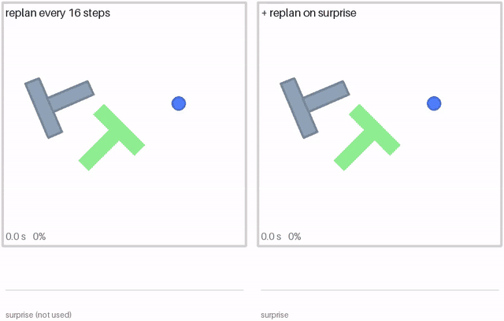
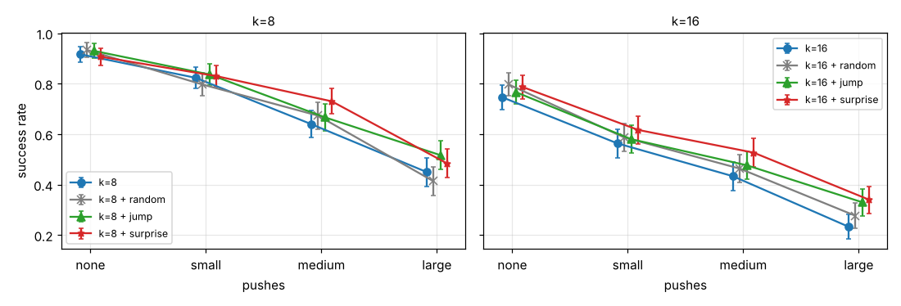
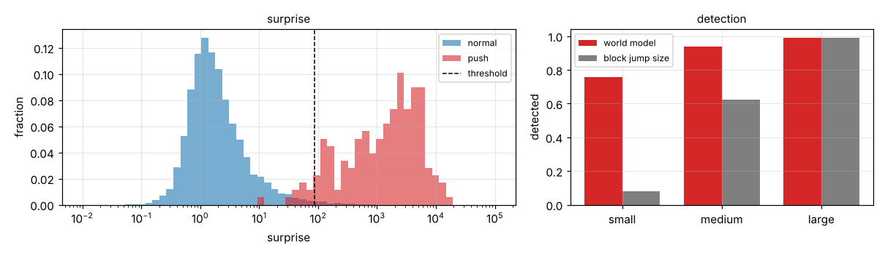

# Surprise-triggered replanning for Diffusion Policy

A state-based Diffusion Policy solves PushT while the block gets pushed away from outside. A small world model runs
next to the policy and predicts the next state; when its prediction error is too large, the robot drops the rest of
its action chunk and replans.



Same start and same pushes on both sides; left replans every 16 steps, right also replans when surprised (red dots).
One hand-picked episode, the numbers below are over 300 episodes. [mp4](media/demo.mp4)

## Background

Diffusion Policy and similar policies predict a chunk of future actions and execute several of them before looking
again. Between two plans the robot is blind: if the object moves, it first finishes the old plan. Replanning more often
helps, but every policy call is expensive (here 10 denoising steps).

The idea comes from predictive coding: the brain predicts the sensory consequences of its own movements, and a mismatch
between prediction and input interrupts what it is doing (e.g. visuomotor mismatch responses in mouse V1, Keller et al.
2012). So: keep executing chunks, run a cheap forward model next to the policy, and only replan early when the world did
not do what was expected.

## Summary

- Own Diffusion Policy (1D conditional UNet, 4.1M parameters), trained on 300 demos from a scripted expert:
  **92%** success on PushT (300 test episodes).
- External pushes reduce success to 82 / 64 / 45% (small / medium / large).
- The world model detects pushes far better than a simple block-jump detector: 76% vs 8% (small), 94% vs 62%
  (medium), both at 1% false alarms per step.
- Replanning on surprise adds **+9 points** for medium pushes (64 → 73%) and **+11 points** for large pushes with
  16-step chunks (23 → 34%), at 1-1.5 extra policy calls per 100 steps. It matches replanning 2-8x more often on a
  fixed schedule.
- Against random replanning at the same rate and against the jump trigger, the difference is 5-7 points but not
  significant with 300 episodes.

## Results

Success rate, 300 episodes per cell (95% CI about ±5 points). k = actions executed per 16-step plan.

| | policy calls / 100 steps | no pushes | small | medium | large |
|---|---|---|---|---|---|
| k=1 | 100 | 86% | 77% | 56% | 51% |
| k=2 | 50 | 92% | 81% | 63% | 48% |
| k=4 | 25 | 92% | 85% | 67% | 48% |
| **k=8** | 12.7 | 92% | 82% | 64% | 45% |
| k=16 | 6.4 | 75% | 56% | 43% | 23% |
| **k=8 + surprise** | 13.7 | 91% | 83% | **73%** | 48% |
| k=8 + jump | 13.7 | 93% | 84% | 67% | 52% |
| k=8 + random | 13.5 | 93% | 80% | 67% | 41% |
| **k=16 + surprise** | 7.9 | 79% | 62% | 53% | **34%** |
| k=16 + jump | 7.4 | 77% | 58% | 48% | 33% |
| k=16 + random | 7.6 | 80% | 59% | 46% | 28% |

Paired differences (percentage points, 95% bootstrap CI):

| | no pushes | small | medium | large |
|---|---|---|---|---|
| k=8 + surprise vs k=8 | -1 [-6, +4] | +1 [-5, +7] | **+9 [+2, +16]** | +3 [-4, +11] |
| k=8 + surprise vs k=8 + random | -3 [-7, +2] | +3 [-3, +9] | +6 [-1, +13] | +7 [-1, +15] |
| k=16 + surprise vs k=16 | +4 [-2, +10] | +5 [-2, +13] | **+9 [+1, +17]** | **+11 [+3, +18]** |
| k=16 + surprise vs k=16 + random | -1 [-7, +6] | +3 [-5, +10] | +6 [-2, +14] | +6 [-1, +14] |





All plots and the full analysis: [`eval/eval.ipynb`](eval/eval.ipynb), overview in [`eval/README.md`](eval/README.md).

## Limitations

- State based: on a real robot the block pose would come from a camera and pose estimator.
- Simulation only; pushes are teleports of the block, not forces.
- Demos come from a scripted planner, not from humans; one policy and one world model, trained once.
- Single trigger threshold (1% false alarms per step), calibrated on clean rollouts.
- Compute counts policy calls only; the world model is orders of magnitude cheaper and not counted.

## Run

```
pip install -r requirements.txt
python collect_demos.py      # expert demos
python train_policy.py       # diffusion policy, ~50 min on one CPU core
python worldmodel.py         # world model
python eval/benchmark.py     # all strategies x push sizes, ~2 h, resumable
python eval/detection.py
jupyter nbconvert --execute --to notebook --inplace eval/eval.ipynb
python eval/make_video.py --seed 30033   # demo clip
```

Trained weights are in `runs/`, all results in `eval/results/`.

Developed locally and pushed in one go, so the commit history is short. The plotting code, figures and demo video were
made with Claude (Anthropic).

## References

- Chi et al. (2023). Diffusion Policy: Visuomotor Policy Learning via Action Diffusion. RSS.
- Keller, Bonhoeffer, Hübener (2012). Sensorimotor mismatch signals in primary visual cortex of the behaving mouse. Neuron.
- Wolpert, Ghahramani, Jordan (1995). An internal model for sensorimotor integration. Science.
